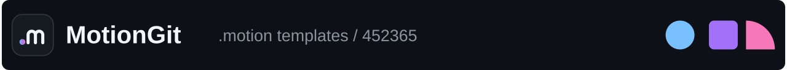
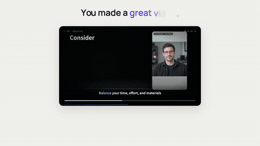
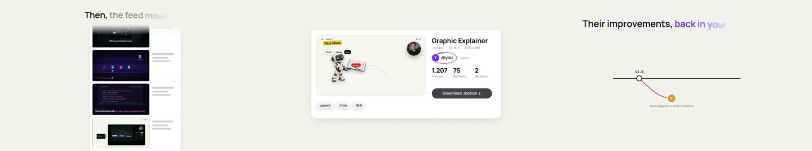

# Modular Collage · Creator Tools

Show how content, assets and animation fit together through modular collages for creator tools.

**16:9 · 1920 × 1080 · 60 fps · v2.5.5** · [@motiongit](https://motiongit.com/@motiongit) · [简体中文](README.zh-CN.md)

**[Template details, full .motion & demo](https://motiongit.com/@motiongit/motiongit-promo-creator)**
https://motiongit.com/@motiongit/motiongit-promo-creator

Download available; current terms are listed with the package.

## Demo

[Full demo](https://motiongit.com/@motiongit/motiongit-promo-creator) · [Play video](https://media.openaicut.com/previews/589/draft-en-9fbec6ff121c.mp4)

## How it works

- Declared runtime profile: html-canvas/1.
- Editable inputs are mapped through the template parameter schema and preset to its existing animation project.
- The declared timeline has a fixed duration; new content fits its existing scene order and timing.

Demo duration: **59.25s**. The documented output is 1920 × 1080, 60 fps. The public demo is 59.25 seconds. Use the actual package parameter bounds; extra materials do not automatically create extra scenes. Changing the scene order or engine; the frozen original source and timeline remain authoritative. Automatic replacement of product images/videos or brand paths/marks: no declared media import slot in this candidate. Preserve fixed demonstration visuals only when they are relevant; otherwise this route is not suitable.

## Inputs and materials

- **Required:** Your topic, script and facts to preserve.
- **Optional:** The current voice recording or your narration preference for this production.
- **Optional:** A licensed music track or your preference for music in this production.

Useful for: Fixed landscape animation using the listed public text/display-data/palette slots, current narration and independently supplied licensed music.

## Runtime requirements

- The package declares a Python and Node.js host. Check its dependency lock for supported versions and any additional rendering tools.
- Use the package dependency lock and setup/check instructions. Check existing tools first, install only missing requirements and verify a preview.

## Use the template

1. Obtain the current .motion package from the [template page](https://motiongit.com/@motiongit/motiongit-promo-creator).
2. Extract or load it as documented, then read the included README and referenced production guide.
3. Use your own content and materials, reuse the working environment, and follow the package entry point to inspect a real preview.

You can give an assistant the repository URL and this request:

> https://github.com/motiontemplates/452365
>
> Use this .motion template with my content. Obtain the package from https://motiongit.com/@motiongit/motiongit-promo-creator, extract or load it as documented, read the included README and referenced guide, reuse my working environment, and follow the package workflow to show an actual preview.

## .motion format

MotionGit .motion is a reusable video-template format that organizes the animation project, parameters, assets, dependencies and production guide. Its runtime uses new content to produce a finished video. [Format documentation](https://motiongit.com/spec)

[Versions, license & full download](https://motiongit.com/@motiongit/motiongit-promo-creator) · [Production reference](ASSISTANT.md)
